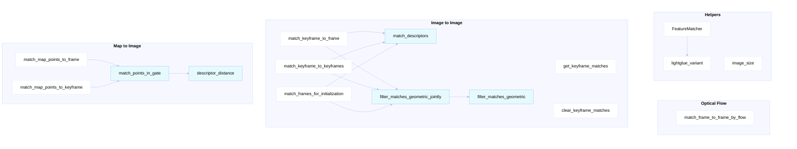

# AllFeature-VSLAM

## Feature Matching  -  `FeatureMatcher.cpp/.h`

**Functions with heuristics (explicit knobs)**
- **`match_descriptors`**
  - LightGlue `filter_threshold = 0.1`: minimum match score (from the model's sidecar `.onnx.yaml`)
  - LightGlue padded export `L1024`: pairs with more than 1024 keypoints a side run on the slower dynamic file (`features_static_shapes`)
- **`filter_matches_geometric`**
  - `filter_inlier_threshold_px = 3.0`: RANSAC Sampson error and refinement loss, in pixels
  - `filter_min_inliers = 8`: below it (matches, RANSAC inliers or survivors) everything is returned unfiltered
  - `filter_min_iterations = 100`, `filter_max_iterations = 1000`: RANSAC iteration bounds
  - `ChiSquared::dof1_95 = 3.841`: per-match bound on the epipolar residual, scaled by the keypoints' covariances
- **`match_map_points_to_frame`**
  - `projection_match_scale_sigma2 = 64`: the gate, 8σ of each keypoint's own variance
- **`match_map_points_to_keyframe`** (values chosen by the caller)
  - `gate_scale_sigma2`: 64 by default (loop search, Loop Closing's fusion); `LocalMapping::FUSE_GATE_SCALE_SIGMA2 = 5.991` in Local Mapping's fusion
  - `max_descriptor_distance`: no limit by default; both fusions pass the `LocalMapping.FuseDescriptorQuantile = 0.5` quantile of point-to-observation descriptor distances, estimated per keyframe
- **`match_frame_to_frame_by_flow`**
  - `flow_window_px = 21`, `flow_pyramid_levels = 3`: KLT window and pyramid
  - `flow_max_iterations = 30`, `flow_epsilon = 0.01`: KLT stopping criteria
  - `Tracking.FlowMaxBackwardError = 1.0` px: forward–backward round-trip tolerance
  - `Tracking.FlowAssociationRadius = 2.0` px: how far a flowed point may be from the keypoint it takes

**ONNX Models**
`pixi` environment: `export-features`
`pixi run -e export-features export-superpoint` = `python tools/export_features.py --only superpoint`
- Clone `cvg/LightGlue` to `tools/lightglue/`: pinned to commit eb42fee. **It holds the model code for SuperPoint, ALIKED, SIFT and LightGlue.**
- Downloads the original weights from *LightGlue GitHub release* to `feature_models/.cache/hub/checkpoints`: `superpoint_v1.pth`, `aliked-n16.pth`, and the three `*_lightglue_v0-1_arxiv.pth`.
- Export the weights to `feature_models/superpoint_v1.onnx`
- With --static WxH it exports `superpoint_v1_672x416.onnx, _739x458`

At run time:
- Each run creates the ONNX Runtime Session from the .onnx file at startup

## Feature Matching - Helpers
#### FeatureMatcher (constructor)
Loads and warms up the LightGlue variant of every learned feature in `feature_types`, so no session is created later on the tracking thread. Holds no state; `name` is only for the log.

- **Used in**: `Tracking`, `LocalMapping`, `LoopClosing` (one matcher each)
- **Calls**: `lightglue_variant`, `onnx::preload_lightglue`, `onnx::shared_lightglue`
- **Heuristics**: none
  - the sessions are process-wide; the OpenCV-threading and "LightGlue ready" lines are logged once per process
- **Report**: none

#### image_size
The size of the image a view's keypoints were detected in: its calibration's width and height (as resized and cropped). Used to give LightGlue one size per side.

#### lightglue_variant
The LightGlue variant name of a learned matcher type ("superpoint", "aliked", "sift"); `nullptr` for the brute-force types.

## Feature Matching - Image to Image

#### match_descriptors
The matches between the keypoints of two images for one feature type, with the matcher that feature declares: LightGlue for learned features, mutual nearest neighbour brute force for the others.

- **Used in**: `match_keyframe_to_frame`, `match_keyframe_to_keyframes`, `match_frames_for_initialization`
- **Calls**: `onnx::shared_lightglue(...).match`, `bruteforce_match_l2`, `bruteforce_match_hamming`
- **Writes**:
  - returns: `cv::DMatch` list (queryIdx: first set, trainIdx: second); `distance` is 1 − score for LightGlue, L2 or Hamming for brute force (not comparable across types)
- **Heuristics**: none of its own
  - brute force: mutual nearest neighbour, no distance threshold, global (every descriptor against every other)
  - LightGlue: mutual argmax with score > `filter_threshold` (0.1, from the model's sidecar yaml); one image size per side for keypoint normalisation
  - LightGlue export: the smallest padded export that holds the larger side (`L1024`), else the slower dynamic file
  - an empty side returns no matches; a failed LightGlue run is caught and returns no matches
- **Report**: none

#### filter_matches_geometric
Keeps the matches consistent with one calibrated two-view geometry: an essential matrix (PoseLib LO-RANSAC, 5-point), then each match re-tested against its own keypoints' covariances. One camera per view.

- **Used in**: `match_keyframe_to_frame`, `match_keyframe_to_keyframes`, `match_frames_for_initialization`, through `filter_matches_geometric_jointly`
- **Calls**: `poselib::estimate_relative_pose`, `poselib::essential_from_motion`
- **Writes**:
  - returns: the surviving matches, in input order
- **Heuristics**:
  - `filter_min_inliers = 8`: fewer matches, RANSAC inliers or final inliers → all matches returned unfiltered (fail-open)
  - `filter_inlier_threshold_px = 3.0`: RANSAC Sampson error and refinement loss, in pixels
  - `filter_min_iterations = 100`: lower bound on RANSAC iterations
  - `filter_max_iterations = 1000`: finds the model down to about 30% inliers
  - `ChiSquared::dof1_95 = 3.841`: per-match bound, scaled by J₁Σ₁J₁ᵀ + J₂Σ₂J₂ᵀ
- **Report**:
  - `filter.model`: 1 essential matrix, 0 unfiltered
  - `filter.inliers_ransac`
  - `filter.inliers`

#### filter_matches_geometric_jointly
`filter_matches_geometric` on the matches of several feature types at once: pools them, filters once, splits the survivors back by type. Machinery.

- **Used in**: `match_keyframe_to_frame`, `match_keyframe_to_keyframes`, `match_frames_for_initialization`
- **Calls**: `filter_matches_geometric`
- **Writes**:
  - returns: surviving matches per feature type (a type with none is absent)
- **Heuristics**: none
  - one model for all feature types; the type with the most matches dominates, and an "unfiltered" fallback affects every type
- **Report**: none of its own

#### match_keyframe_to_frame
Builds 2D–3D correspondences between a frame and a keyframe's map points by global descriptor matching.

- **Used in**: `Tracking::track_reference_keyframe`, `Tracking::relocalize`
- **Calls**: `match_descriptors`, `filter_matches_geometric_jointly`
- **Writes**:
  - returns: map-point matches per feature type
  - `frame.cache_matched_pairs_feat_type[keyframe->frame_id]`: every filtered pair
- **Heuristics**: none
- **Report**:
  - `keyframe.frame_id`
  - `matches.raw`: before the geometric filter
  - `matches.filtered`: after the geometric filter
  - `matches.with_point`: filtered matches whose keyframe keypoint has a valid map point

#### match_keyframe_to_keyframes
Makes sure a keyframe's match cache holds filtered matches against each of the given keyframes; only pairs not cached yet are matched.

- **Used in**: `LocalMapping::create_new_map_points` (triangulation neighbours), `LoopClosing::compute_sim3` (loop candidates)
- **Calls**: `match_descriptors`, `filter_matches_geometric_jointly`
- **Writes**:
  - `keyframe->cache_matched_pairs_feat_type[other->frame_id]`: the filtered pairs, on the querying keyframe only (read back with `get_keyframe_matches`, released with `clear_keyframe_matches`)
- **Heuristics**: none
  - pending pair: no cache entry, or an empty one (a pair that matched nothing is re-matched)
  - matching runs in parallel over pairs × feature types; the filter runs pair by pair on the calling thread
- **Report** (only when a pair was pending):
  - `matches.raw`: before the geometric filter, summed over the pairs matched in this call
  - `matches.filtered`: after the geometric filter, summed the same way

#### get_keyframe_matches
The matched keypoint pairs (index in keyframe1, index in keyframe2) that keyframe1's cache holds for keyframe2, per feature type. A read only: a pair not cached first gives nothing. Machinery.

- **Used in**: `LocalMapping::create_new_map_points`, `LoopClosing::compute_sim3`
- **Heuristics**: none
- **Report**: none

#### clear_keyframe_matches
Releases every match list a keyframe holds (all pairs, including the one inherited from tracking). Machinery.

- **Used in**: `LocalMapping::process_keyframe`, `LoopClosing::run`
- **Heuristics**: none
- **Report**:
  - `cache.entries`: cache entries released
  - `cache.matches`: matches released

#### match_frames_for_initialization
Matched keypoint pairs between two frames for monocular initialization: descriptor matching per feature type, then the geometric filter on all types jointly. No map points, no cache.

- **Used in**: `Tracking::attempt_monocular_initialization`
- **Calls**: `match_descriptors`, `filter_matches_geometric_jointly`
- **Writes**:
  - returns: (index in frame1, index in frame2) pairs per feature type, with an entry for every requested type (empty if none survive)
- **Heuristics**: none
  - serial on the tracking thread, so the LightGlue run keeps its priority
  - the frames come from the denser initialization extractor (4× the budget), so LightGlue pairs run on the dynamic export
  - the `Initializer` runs its own H/F RANSAC on these pairs afterwards
- **Report**:
  - `matches.raw`: before the geometric filter
  - `matches.filtered`: after the geometric filter

## Feature Matching - Map to Image
#### match_points_in_gate
Gives each candidate map point at most one free keypoint near its projection: a keypoint inside the point's gate (scaled by the keypoint's own variance), accepted when each side is the other's best descriptor match.

- **Used in**: `match_map_points_to_frame` (tracking, relocalization), `match_map_points_to_keyframe` (loop search, both fusions)
- **Calls**: `MapPoint::get_descriptor`, `FeatureMatcher::descriptor_distance`, and the caller's `keypoints_in_area`, `is_free`, `assign`
- **Writes**:
  - through `assign`: each accepted (keypoint, map point) pair
  - returns: `GateMatchCounts` per feature type
- **Heuristics**:
  - `gate`: max offsetᵀ · information · offset (squared sigmas); 64 (8σ) for tracking, relocalization and loops, 5.99 for Local Mapping's fusion
  - `max_distance`: max descriptor distance of an accepted pair; no limit except fusion (the map's estimated quantile)
  - mutual nearest neighbour inside the gate instead of a descriptor threshold; ties keep the first of equal distances
  - search radius `sqrt(gate × largest free-keypoint variance)`: one coarse keypoint widens the lookup for its whole type
- **Report**: none of its own; the callers report its counts:
  - `points.candidates`: candidate map points
  - `keypoints.unmatched`: free keypoints
  - `matches.raw`: candidates with a free keypoint in their gate
  - `matches.accepted`: mutual pairs accepted

#### descriptor_distance
Distance between two descriptors of one feature type: dispatches to the feature's own metric (`get_feature(type).descriptor_distance`).

- **Used in**: `match_points_in_gate`, `MapPoint::compute_distinctive_descriptors`, `LocalMapping::estimate_fuse_max_descriptor_distance`
- **Calls**: `get_feature`, `Feature::descriptor_distance` (virtual)
- **Writes**:
  - returns: the distance
- **Heuristics**: none
  - metric per feature: Hamming for orb32 (own POPCNT), akaze61, brisk48; L2 for aliked128, superpoint256 (normalised, 0–2), sift128 (RootSIFT), kaze64
  - not comparable across feature types
  - the base class returns 0 if a feature doesn't override it
- **Report**: none

#### match_map_points_to_frame
Gives the frame's free keypoints a map point from projected candidates.

- **Used in**: `Tracking::search_local_points` (every tracked frame), `Tracking::accept_relocalization_hypothesis` (`match_more_points`)
- **Calls**: `match_points_in_gate`
- **Writes**:
  - `frame.pts[type][keypoint]`: each accepted pair (overwrites a dead point)
- **Heuristics**:
  - `projection_match_scale_sigma2 = 64`: the gate, 8σ of each keypoint's own variance
  - no descriptor limit: mutual agreement decides; pose optimization rejects wrong pairs afterwards
  - free keypoint: no map point, or a dead one (zero observations)
- **Report**:
  - `points.candidates`: candidate map points
  - `keypoints.unmatched`: free keypoints
  - `matches.raw`: candidates with a free keypoint in their gate
  - `matches.accepted`: mutual pairs accepted

#### match_map_points_to_keyframe
Gives a keyframe's free keypoints of one feature type a map point from projected candidates, into a vector the caller owns.

- **Used in**: `LoopClosing::search_loop_map_points`, `LoopClosing::search_and_fuse`, `LocalMapping::fuse_into_keyframe`
- **Calls**: `match_points_in_gate`
- **Writes**:
  - `matched_points[keypoint]`: each accepted pair
- **Heuristics**:
  - `gate_scale_sigma2`: default 64 (8σ); 5.99 in Local Mapping's fusion
  - `max_descriptor_distance`: default no limit; fusion passes the map's estimated quantile
  - free keypoint: of `feat_type` with an empty slot in `matched_points` (all empty in fusion: occupied keypoints are open, to find duplicates)
- **Report**:
  - `points.candidates`: candidate map points
  - `keypoints.unmatched`: free keypoints
  - `matches.raw`: candidates with a free keypoint in their gate
  - `matches.accepted`: mutual pairs accepted

## Feature Matching - Optical Flow
#### match_frame_to_frame_by_flow
Carries the last frame's tracked map points into the current frame by optical flow (KLT forward and backward), then gives each one to the nearest detected keypoint of its feature type. No descriptors.

- **Used in**: `Tracking::track_with_optical_flow`
- **Calls**: `cv::calcOpticalFlowPyrLK` (twice), `Calibration::undistort`, `Frame::get_features_in_area`
- **Writes**:
  - `frame.pts[type][keypoint]`: each snapped map point
  - returns: `FlowMatchCounts{tracked, survived, matched}`
- **Heuristics**:
  - `flow_window_px = 21`: KLT window
  - `flow_pyramid_levels = 3`: KLT pyramid levels above the image
  - `flow_max_iterations = 30`, `flow_epsilon = 0.01`: KLT stopping criteria
  - `max_backward_error` (1.0 px, `Tracking.flow_max_backward_error`): a track must return this close to where it started
  - `association_radius` (2.0 px, `Tracking.flow_association_radius`): a flowed point takes the nearest keypoint within this; a keypoint claimed twice keeps the closer track
  - position only: no descriptor check, and the radii don't scale with the keypoint's sigma
- **Report**:
  - `flow.tracked`: last-frame keypoints with a good map point
  - `flow.survived`: tracks that pass the forward–backward check and land inside the image
  - `flow.matched`: keypoints given a map point
